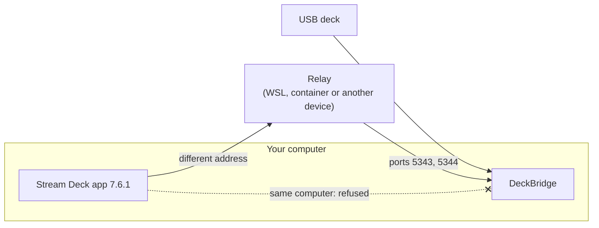

import ThemedImage from '@theme/ThemedImage';

Stream Deck app 7.6.1 refuses a network dock on its own computer. A new **Fix pairing** wizard works around it. Also new: the Ulanzi D200, one-click updates, and extensions.

{/* truncate */}

This post covers 0.21 to 0.26.3. Screenshots come from the Web UI in mock mode.

## Pair on the same computer as the Stream Deck app

Since 7.6.1, the Stream Deck app does not connect to a network dock on its own computer ([#257](https://github.com/lukasMega/DeckBridge/issues/257)). A relay fixes it: the app connects to the relay at a different address, and the relay passes everything on to DeckBridge. DeckBridge detects this and opens the wizard. The wizard checks your computer and recommends a fix:

- **Use app 7.6.0** and turn off its updates.
- **Relay on another device**, such as a Raspberry Pi. You paste one command there.
- **Relay in WSL** on Windows.
- **Relay in Apple container** or **OrbStack** on a Mac.

<ThemedImage
  sources={{
    light: require('./0-26-mac-choose.png').default,
    dark: require('./0-26-mac-choose-dark.png').default,
  }}
  alt="Fix pairing wizard, Choose a fix: Use Stream Deck app 7.6.0, Relay in Apple container on this Mac (Recommended, installed), and Relay in OrbStack on this Mac, each with memory, disk, setup time and cost"
  width={454}
/>

How the relay works

Every address fails with 7.6.1: `127.0.0.1`, the LAN IP, a Tailscale IP. App 7.6.0, or the app on another computer, still works. A relay is a small program between the app and DeckBridge. The app sees it at a different address, so it connects.

On Windows, DeckBridge runs the relay in WSL2 for you. It downloads the matching Linux release, checks its SHA256 checksum, and starts it. Then it shows the IP to add in the Stream Deck app as a Network Dock by IP.

<ThemedImage
  sources={{
    light: require('./0-26-wsl-setup.png').default,
    dark: require('./0-26-wsl-setup-dark.png').default,
  }}
  alt="Relay in WSL on this PC: WSL is ready, Relay downloaded, Relay reaches DeckBridge are checked. Step 4 shows the IP 172.28.16.5 to add in the Stream Deck app."
  width={454}
/>

On macOS 26 with Apple silicon, the relay runs in Apple container, Apple's free tool for small Linux VMs. We paired Stream Deck 7.6.1 through it on macOS 27.2. If macOS blocks the Stream Deck app from the local network, the wizard and the diagnostics report say so.

The relay keeps the app connected while DeckBridge restarts, for up to 60 seconds by default. The deck comes back with no new pairing.

The WSL route is not yet tested on many real PCs. If a step fails, please [open an issue](https://github.com/lukasMega/DeckBridge/issues/257) with the diagnostics report. See [Elgato app 7.6.1 on the same computer](/elgato-same-computer).

## Ulanzi D200

The D200 has 13 LCD keys on a 5×3 grid and a wide info window. Its firmware shows GIF, PNG and JPEG images natively, and GIFs animate on the deck itself. The **Info window** section sets what that window shows: a clock, a dial, system stats, a DeckBridge widget, or the Elgato app's images for keys 14 and 15.

<ThemedImage
  sources={{
    light: require('./0-26-d200.png').default,
    dark: require('./0-26-d200-dark.png').default,
  }}
  alt="Connected Ulanzi Stream Controller D200: live preview of the 5 by 3 key grid with brightness, and the Info window section with a clock preview and the Content, Hours and Sends to fields"
  width={454}
/>

Technical details

DeckBridge shows the D200 to the Elgato app as a Stream Deck MK.2. The D200 has no per-key write: the whole page goes to the deck as one ZIP of JPEG icons. Later updates send only the keys that changed.

A GIF keeps animating on all 13 keys and in the info window, also while other keys update. DeckBridge sends JPEG for now. The Elgato app sends animations frame by frame, so a GIF has to come from DeckBridge itself.

**Sends to** sets where a press of the window goes: Elgato key 14 or 15, a DeckBridge action, or nothing. Changes apply at once, with no reconnect. The Web UI also shows the firmware version.

See [D200 info window](/plugin-widgets#d200-info-window) and [Supported devices](/devices).

## One-click updates

DeckBridge checks GitHub once a day and shows a banner when a new release is out. With the Windows installer or the macOS app, click **Install**. DeckBridge restarts on the new version in a few seconds.

<ThemedImage
  sources={{
    light: require('./0-26-update-banner.png').default,
    dark: require('./0-26-update-banner-dark.png').default,
  }}
  alt="Web UI banner: DeckBridge v0.27.0 is available, with Install v0.27.0 and Release notes"
  width={454}
/>

Details

A new release also shows a tray item and one system notification per version. **Install** is in the banner and in **Settings → Updates**. DeckBridge downloads the update, checks its signature, and installs it. If the download or the check fails, the old version starts again. An open Web UI tab reloads by itself.

The **Install** button exists from 0.26.0 on, so you install 0.26 by hand once. The portable zip and Linux get a **Download** link instead. To stop the check, turn off **Check for updates** in Settings.

See [Upgrading](/upgrading).

## Extensions, and Statistics as the first one

An extension adds an optional feature without making DeckBridge bigger for everyone. **Statistics** is the first one: counters for presses, reconnects and key images, with a 15-minute activity chart. It ships as a separate zip on the releases page.

Install and safety

Unzip it into the extensions folder, click **Rescan** in **Settings → Extensions**, and switch it on.

An extension runs in its own worker thread, so a crash or an endless loop does not take DeckBridge down. That thread is not a sandbox: an extension has the same rights as DeckBridge. So DeckBridge records a digest of the extension's files when you switch it on, and stops it if the files change. Settings import never switches an extension on. `DECKBRIDGE_NO_EXTENSIONS=1` starts none, for one session.

See [Extensions](/extensions).

## Also new

- **More decks:** 12 AKP05-family clones, the upHere 293V3, and more. See [Supported devices](/devices).
- **Device check wizard** for untested decks. See [Device check](/verify-device).
- **Last icons after a restart** until the Elgato app sends new ones.
- **Choose which decks run** in **Settings → Multiple decks**.
- A [live demo](/demo) of the Web UI on this site.

All small changes

- **More decks:** 12 AKP05-family clones (SS552, N4, MSD-PRO and others), the upHere 293V3, a second Mirabox K1 Pro ID (`0x5548:0x1025`), and the Mirabox 293 gen 1 (not yet tested).
- **Device check wizard:** fix rotated, mirrored, shuffled or black key images, then send the report.
- **Multiple decks:** DeckBridge lists up to four decks, and you tick the two to run. A single-instance lock stops a second DeckBridge from fighting the first for the deck.
- **Device tuning** of the key map applies live, with no reconnect.
- **Free Web UI port:** if port 3000 is busy, DeckBridge picks a free one.
- **Brightness** on the pairing screen.
- A short in-app feedback survey.

