# Features & Use Cases

DeckBridge turns a USB Stream Deck into a network device the Elgato app can use over WiFi.

## Live demo

[Try the live demo](/demo) with a mock deck in your browser. You install nothing. In desktop Chrome, Edge or Opera, real device mode drives your deck's keys and brightness over WebHID (plus the strip and knobs on AKP05 and AKP05E).

## Use a budget deck with the Elgato app

DeckBridge lets the **official Elgato Stream Deck app** drive cheap, non-Elgato decks: Mirabox, Ajazz and similar boards, from 6-key minis to 15-key (3×5) decks. The app sees a regular **Network device** at `localhost`. The deck behaves like Elgato hardware.

<div class="db-stepper" role="group" aria-label="Pairing a budget Stream Deck with DeckBridge in four steps">
<input type="radio" name="db-step" id="db-s1" />
<input type="radio" name="db-step" id="db-s2" />
<input type="radio" name="db-step" id="db-s3" />
<input type="radio" name="db-step" id="db-s4" />
<div class="db-stage">
<svg viewBox="0 0 760 300" xmlns="http://www.w3.org/2000/svg" role="img" aria-label="DeckBridge pairing scene">
<rect x="4" y="4" width="752" height="292" rx="16" fill="#f5f6f8" stroke="#e2e5eb"/>
<polygon points="58,222 292,222 308,236 42,236" fill="#c2c7d2" stroke="#b0b6c2"/>
<rect x="70" y="86" width="210" height="132" rx="10" fill="#ffffff" stroke="#d2d6df" stroke-width="2"/>
<rect x="72" y="88" width="206" height="24" rx="6" fill="#4f63d2"/>
<text x="82" y="105" fill="#ffffff" font-size="13" font-weight="700" font-family="sans-serif">DeckBridge</text>
<circle class="db-sdot" cx="86" cy="142" r="5"/>
<text class="db-status st1" x="98" y="146" font-size="12" fill="#6b7280" font-family="sans-serif">Starting…</text>
<text class="db-status st2" x="98" y="146" font-size="12" fill="#6b7280" font-family="sans-serif">Waiting for USB…</text>
<text class="db-status st3" x="98" y="146" font-size="12" font-weight="600" fill="#2bb673" font-family="sans-serif">Mirabox detected</text>
<text class="db-status st4" x="98" y="146" font-size="12" font-weight="600" fill="#2bb673" font-family="sans-serif">Streaming to Elgato</text>
<text x="82" y="178" font-size="10" fill="#9aa0ad" font-family="sans-serif">Network dock · CORA :5343</text>
<g class="db-cable"><path d="M286 150 C 352 150, 372 196, 444 196" fill="none" stroke="#9aa0ad" stroke-width="7" stroke-linecap="round"/><rect x="436" y="188" width="16" height="16" rx="3" fill="#7a8290"/></g>
<rect x="430" y="110" width="270" height="170" rx="16" fill="#23262e" stroke="#0f1115" stroke-width="2"/>
<rect class="db-btn" x="444" y="124" width="42" height="42" rx="6"/>
<rect class="db-btn" x="494" y="124" width="42" height="42" rx="6"/>
<rect class="db-btn" x="544" y="124" width="42" height="42" rx="6"/>
<rect class="db-btn" x="594" y="124" width="42" height="42" rx="6"/>
<rect class="db-btn" x="644" y="124" width="42" height="42" rx="6"/>
<rect class="db-btn" x="444" y="174" width="42" height="42" rx="6"/>
<rect class="db-btn" x="494" y="174" width="42" height="42" rx="6"/>
<rect class="db-btn" x="544" y="174" width="42" height="42" rx="6"/>
<rect class="db-btn" x="594" y="174" width="42" height="42" rx="6"/>
<rect class="db-btn" x="644" y="174" width="42" height="42" rx="6"/>
<rect class="db-btn" x="444" y="224" width="42" height="42" rx="6"/>
<rect class="db-btn" x="494" y="224" width="42" height="42" rx="6"/>
<rect class="db-btn" x="544" y="224" width="42" height="42" rx="6"/>
<rect class="db-btn" x="594" y="224" width="42" height="42" rx="6"/>
<rect class="db-btn" x="644" y="224" width="42" height="42" rx="6"/>
<rect class="db-dim" x="4" y="4" width="752" height="292" rx="16" fill="#0b0d12"/>
<g class="db-elg"><rect x="200" y="92" width="360" height="150" rx="14" fill="#ffffff" stroke="#d4d8e0"/><rect x="200" y="92" width="360" height="34" rx="14" fill="#15171c"/><rect x="200" y="112" width="360" height="14" fill="#15171c"/><text x="218" y="114" fill="#ffffff" font-size="13" font-weight="600" font-family="sans-serif">Elgato Stream Deck</text><text x="218" y="150" font-size="11" fill="#6b7280" font-family="sans-serif">Devices › Add a network device</text><rect x="218" y="160" width="324" height="56" rx="8" fill="#f4f6fb" stroke="#dfe3ec"/><rect x="230" y="172" width="32" height="32" rx="5" fill="#23262e"/><text x="274" y="184" font-size="12" font-weight="600" fill="#2b2f38" font-family="sans-serif">Network Stream Deck</text><text x="274" y="201" font-size="11" fill="#4f63d2" font-family="sans-serif">IP  localhost</text><rect x="466" y="172" width="62" height="32" rx="6" fill="#4f63d2"/><text x="497" y="193" fill="#ffffff" font-size="12" font-weight="600" text-anchor="middle" font-family="sans-serif">Pair</text></g>
</svg>
</div>
<div class="db-controls">
<div class="db-caption"><span class="db-cap cap1">1 · Run DeckBridge</span><span class="db-cap cap2">2 · Plug the Stream Deck into USB</span><span class="db-cap cap3">3 · DeckBridge detects the deck</span><span class="db-cap cap4">4 · Pair it in Elgato — Network device · localhost</span></div>
<div class="db-navrow">
<label class="db-nav nav-p1" for="db-s1" title="Previous">‹</label>
<label class="db-nav nav-p2" for="db-s1" title="Previous">‹</label>
<label class="db-nav nav-p3" for="db-s2" title="Previous">‹</label>
<label class="db-nav nav-p4" for="db-s3" title="Previous">‹</label>
<div class="db-dots">
<label class="db-dot dot1" for="db-s1" title="Step 1"></label>
<label class="db-dot dot2" for="db-s2" title="Step 2"></label>
<label class="db-dot dot3" for="db-s3" title="Step 3"></label>
<label class="db-dot dot4" for="db-s4" title="Step 4"></label>
</div>
<label class="db-nav nav-n1" for="db-s2" title="Next">›</label>
<label class="db-nav nav-n2" for="db-s3" title="Next">›</label>
<label class="db-nav nav-n3" for="db-s4" title="Next">›</label>
<label class="db-nav nav-n4" for="db-s4" title="Next">›</label>
</div>
</div>
</div>

## Feature overview

- **Network Dock emulation** — CORA over TCP, advertised by mDNS `_elg._tcp` ("Network Stream Deck"). The app finds it like real hardware.
- **Elgato app on the same computer (7.6.1)** — pair through a relay, WSL or OrbStack. See [Same computer](./elgato-same-computer.md) and the [Node.js relay](./elgato-same-computer.md#relay-node) for macOS.
- **Non-Elgato decks** — [supported](./introduction.mdx#supported-devices) Mirabox / Ajazz decks look like an Elgato model the app knows.
- **Browser deck (opt-in)** — a phone or tablet is one more dock. See [Browser deck](./browser-deck.md).
- **Multiple decks (opt-in, max 2)** — see [Multiple decks](#multiple-decks) and [Limitations](#limitations).
- **Image pipeline** — a Rust library resizes, rotates and (K1 Pro) re-encodes key images, with a cache, off the main thread.
- **Extensions** — optional downloads you switch on in Settings. See [Extensions](./extensions.md). Statistics shows uptime, presses, cache hit rate, reconnects and a 15-minute chart; its data is session-only and stays local.
- **Side-key widgets** — clock, date, text, weather, command and plugin widgets on display-only keys (for example the 293S sixth column). See [Side-key widgets](./side-keys.md).
- **Page-following layouts** — give an Elgato page its own side-key and touch-strip layout. See [Layouts that follow the Elgato page](./side-keys.md#layouts-that-follow-the-elgato-page).
- **Push API** — OBS, Home Assistant, scripts and `deckbridge push` write text to side keys and AKP05/AKP05E strip zones over token-authenticated HTTP, with a TTL. See [Push API](./push-api.md).
- **Standby and burn-in care (opt-in)** — see [Standby and burn-in care](#standby-and-burn-in-care).
- **Live web UI** — `http://localhost:3000` (fallback 33011–33099 if busy): key grid and live log.
- **Device tuning** — rotation, flip, image fit, quality and size per model, plus a key-map learn mode. See [Device tuning](./troubleshooting.md#device-tuning).
- **Logs + diagnostics** — a rotated log file (~6 MB cap) and one pasteable report from the web UI or `./deckbridge diagnose` (works even if the web UI never starts). See [Troubleshooting](./troubleshooting.md).
- **Tray + self-check** — packaged releases have a tray icon ([states](./getting-started.mdx#3-run-it)) and a `/requirements` page.
- **Standalone binary** — one **&lt;5 MB** file on txiki.js. No Node.js.

## Web UI states

| Waiting for USB | Elgato conflict |
|---|---|
| 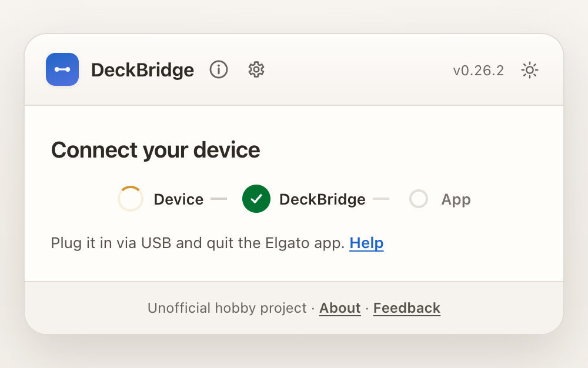 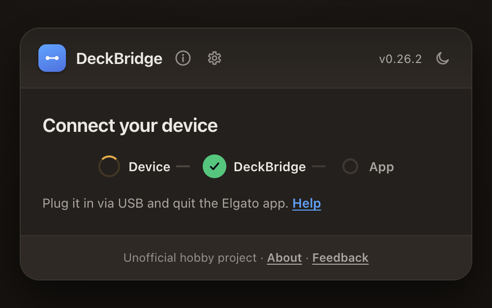 | 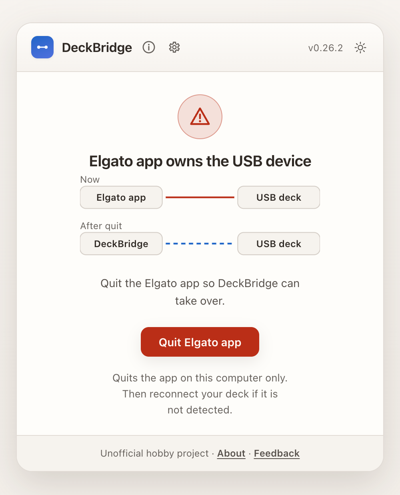 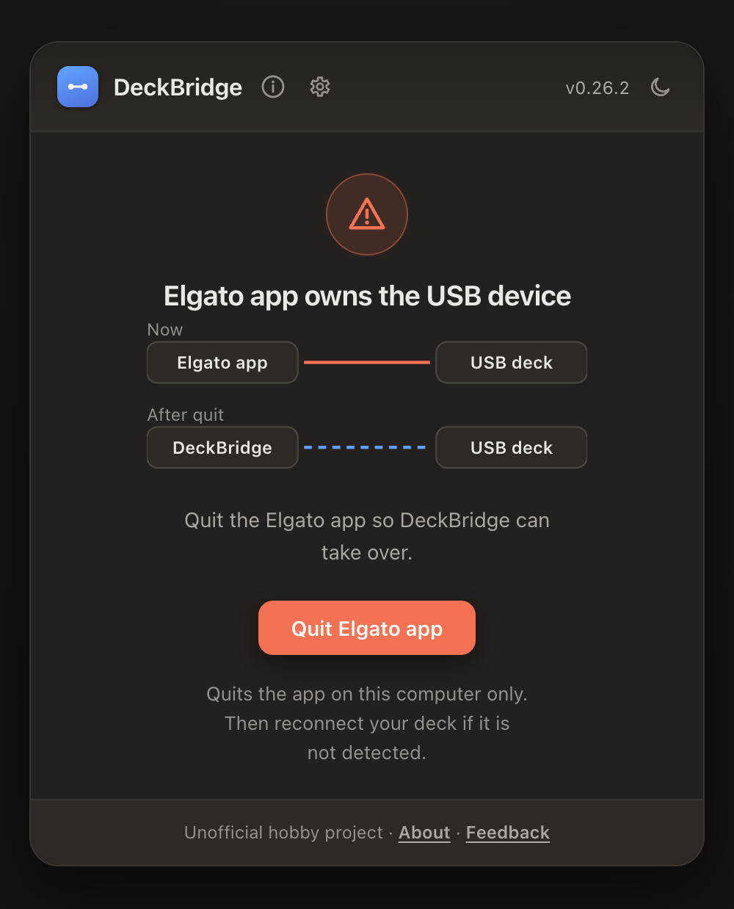 |
| **Ready to pair** | **Connected and working** |
| 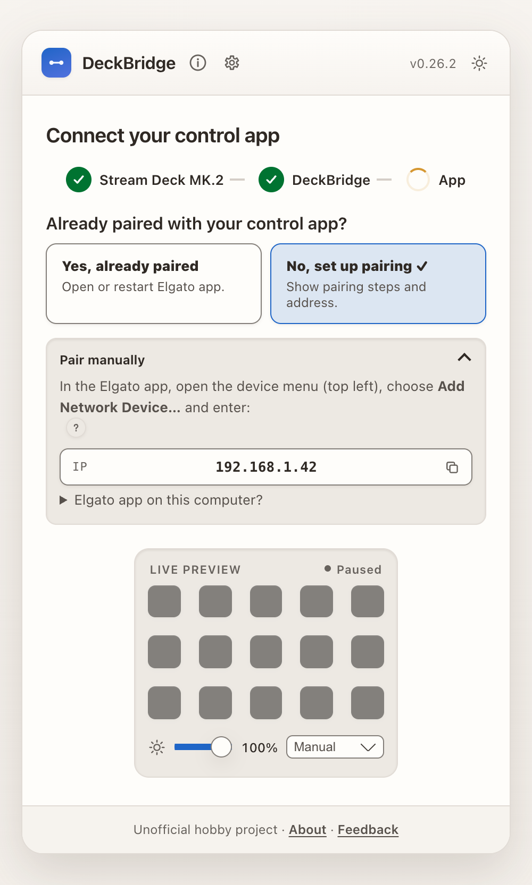 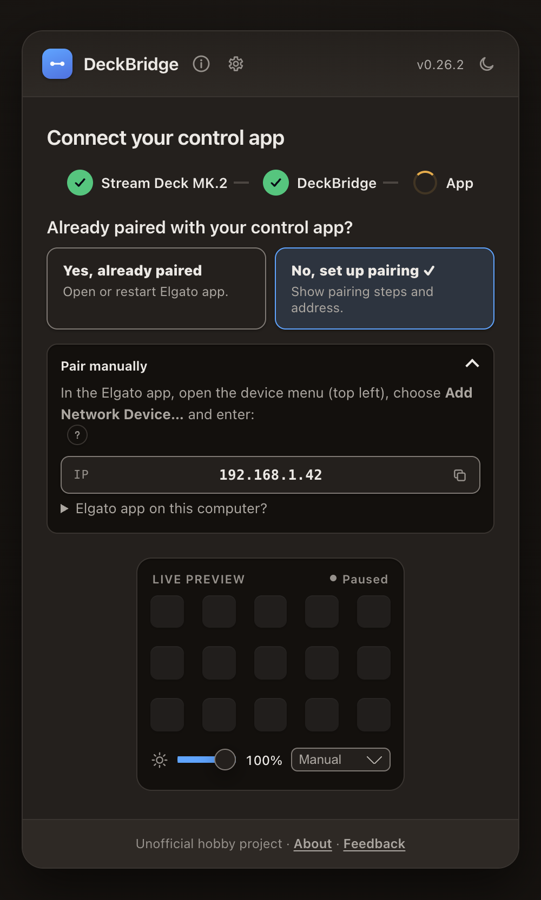 | 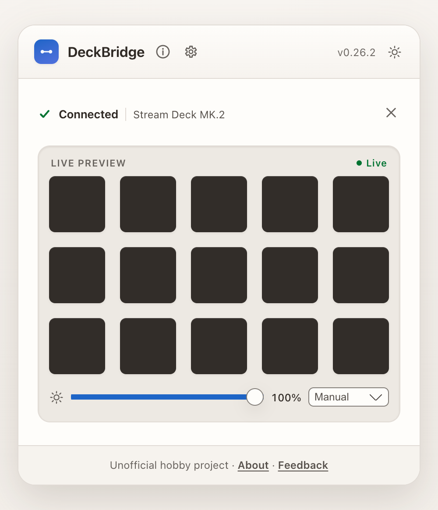 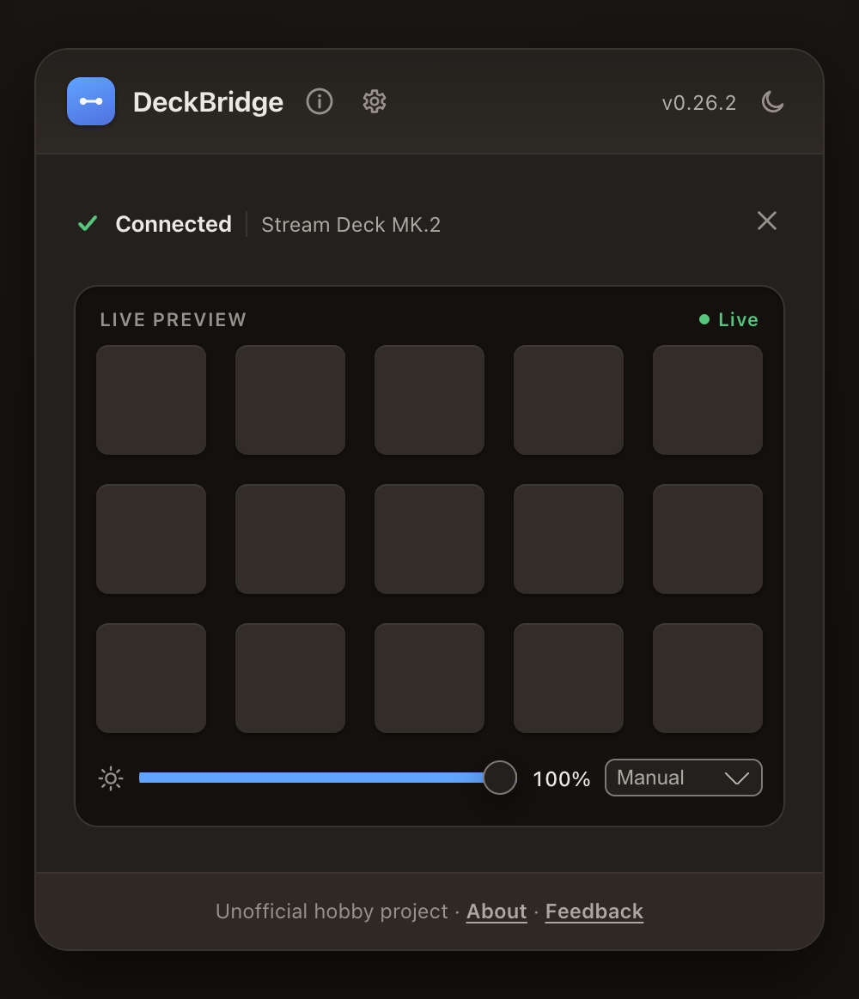 |

### AKP05 as Elgato Stream Deck +

The AKP05 in **Stream Deck +** emulation (mock pairing).

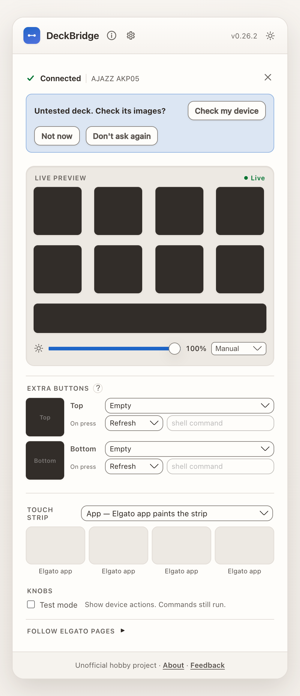 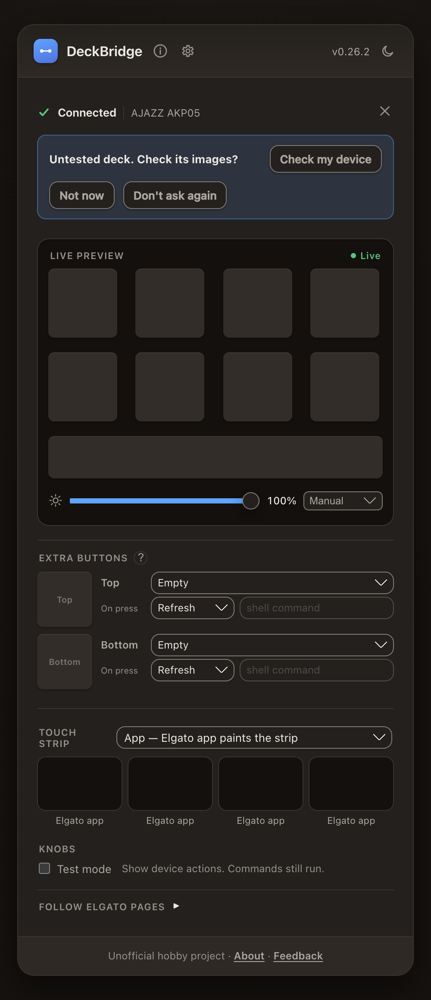

## Use cases

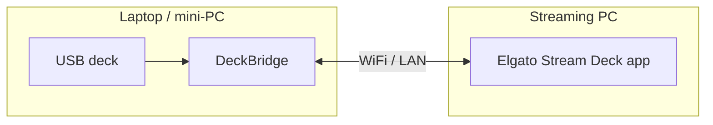

- **Deck on another computer** — plug the deck into a laptop or mini-PC, run DeckBridge there, and control the Elgato app on your streaming PC over the LAN.
- **Skip the Network Dock** — use a computer you own instead of the [Elgato Network Dock](https://www.elgato.com/us/en/p/network-dock-stream-deck) (**$79.99 USD**, September 2026).

  <details class="db-dock-compare">
  <summary>Compare DeckBridge with Network Dock</summary>

  | | DeckBridge | Elgato Network Dock |
  |---|---|---|
  | **Cost** | Free software; needs a running computer. | $79.99 USD hardware (September 2026). |
  | **Connection** | USB deck plugged into that computer; the computer can use WiFi or wired LAN. | [Ethernet and PoE](https://www.elgato.com/us/en/p/network-dock-stream-deck), or Ethernet with separate USB-C power. No computer needed beside the deck. |
  | **Decks** | [Supported Elgato and non-Elgato models](./introduction.mdx#supported-devices); limited device selection. | [Supported Stream Deck models](https://www.elgato.com/uk/en/explorer/products/stream-deck/stream-deck-network-dock-overview/), including XL and +; some older models are excluded. |
  | **Use** | Hobby project with setup flexibility; host computer must stay on. | Dedicated, officially supported hardware for fixed installations; requires purchase and wired network. |

  </details>
- **Real Stream Deck over WiFi** — a Mini or MK.2 works the same way. So does Bitfocus Companion.

<div style="border-left:4px solid #e6a700;background:rgba(230,167,0,0.12);padding:12px 16px;border-radius:6px;margin:20px 0">
<strong>⚠ Hobby use</strong><br/>
DeckBridge is for personal and hobby use, and does not replace the Elgato Network Dock. See the <a href="/introduction">Introduction</a> for the full disclaimer.
</div>

## Multiple decks

**Off by default.** DeckBridge drives one deck and stops scanning USB once it is connected. For two decks (the maximum), open **Settings → Multiple decks** and turn on *Use two decks at once* (`"multiDeck": true` in settings.json). The second deck is its own network dock, with its own mDNS name and CORA port pair (see [Network ports](#network-ports)). The web UI shows one card per deck:

1. **Pair one deck at a time.** An unpaired card shows "Waiting for Elgato app" and `IP : port` copy-chips for **Add Network Device…**. The port differs per deck (5343, 5345, …), so copy it from that card.
2. **The card turns green** ("Paired") when the app connects. The app remembers paired docks.
3. **Click a card to select it.** The selected deck gets the live preview and brightness slider. Each deck keeps its own brightness (also set from the Elgato app, unless "Ignore brightness from Elgato app" is on).

Every dock needs its **own IP address** in the Elgato app: see [one dock per IP address](./browser-deck.md#one-dock-per-ip-address). A phone or tablet can be an extra dock: see the [Browser deck](./browser-deck.md).

<details>
<summary>Advanced: choosing decks, unplugging, single instance</summary>

- **Choosing decks** — DeckBridge detects up to four decks and lists them under **Settings → Multiple decks**. Tick at most two to run. The choice is stored as `"activeDecks"`. With no choice, the first two found run.
- **Unplugging** — an unplugged extra deck loses its card and gets it back when replugged. Turning the setting off disconnects the second deck but keeps its settings.
- **One instance** — a second DeckBridge exits with "DeckBridge is already running". The first one holds loopback TCP port 44659 as a lock.

</details>

## Standby and burn-in care

Cheap LCD panels keep a ghost of a static image. **Settings → Standby & burn-in care** (per selected deck) protects the panel. **Everything is off by default.**

- **Dim when idle** — after N minutes without input, the backlight drops to the level you pick. Any input brings it back.
- **Screen off** — after N more minutes, the screen turns off. *How to turn it off*: `auto` or `brightness0`. No model has a verified hardware sleep yet, so both write brightness 0 today.
- **Wake press** — the first press on a dimmed deck only wakes it. Choose *Wakes and runs the key* to forward it. A web UI click (Click to press) is never swallowed.
- **When the Elgato app is away** — keep the last images (default), show a dim clock, or turn the screen off.
- **Night mode** — between *From* and *To*, brightness is capped at the night level and the idle screen can go dark. It follows the **DeckBridge computer's clock**, time zone and daylight saving.
- **Pixel shift** — moves DeckBridge's own side-key and strip widgets by 1 px every five minutes. The Elgato app's key images never move.

Your brightness slider keeps the level you chose. On the [Browser deck](./browser-deck.md), dim and screen off work on the page, the clock acts as *Turn the screen off*, and pixel shift does not apply.

<details>
<summary>Advanced: "app is away" rules and sleep/wake commands</summary>

DeckBridge waits 15 s before it acts, so app reconnects never flash the clock. It acts only for a paired deck (or one paired since DeckBridge started), and not in the first minute after start. The clock moves to a new key every minute. When the app returns, its last images come back at once. Companion does not count as the Elgato app.

Two optional shell commands run when the screen goes off and when it wakes. Set them per device in `settings.json` only (the web UI never shows them):

```json
{
  "devices": [
    {
      "deviceKey": "usb:A00000000000",
      "standby": {
        "sleepCommand": "osascript -e 'tell application \"System Events\" to sleep'",
        "wakeCommand": "echo woke >> /tmp/deck.log"
      }
    }
  ]
}
```

Like [command widgets](./side-keys.md#security), they run on your host with your rights, so keep the Web UI off untrusted networks. A command gets 10 s, its output is dropped, and only one of each kind runs at a time. `./deckbridge diagnose --redact-commands` hides them in the report.

</details>

## Click to press

**Off by default.** *Settings → Click to press* lets you double-click a key in the web UI preview to press it in the Elgato app (Enter or Space on a focused key works too). The dock must be paired. Anyone who can open the web UI can then press your keys, so keep it on `127.0.0.1` (the default) unless you trust the network. It is stored as `"webuiKeyPress": true` and is never taken from an imported settings file. Key-map learn mode ignores virtual presses.

## Last icons

**Off by default.** After a restart, the Elgato app needs a few seconds to resend its icons. When this is on, DeckBridge shows the icons from the last run meanwhile, each with a small red "!" in its top-right corner. The "!" goes away when the app sends a fresh icon.

Icons are saved in `<cache-root>/last-frames/` and can show private text such as titles or calendar entries. *Settings → Last icons* turns this on (`"keepLastIcons": true`). Turning it off deletes the files.

<details>
<summary>Advanced: timing and limits</summary>

- About 30 s after the first fresh icon, keys the app did not repaint (for example after a profile change) go blank and their saved icon is deleted.
- If the app never reconnects, saved icons and their "!" stay up to 24 hours, then are dropped.
- Not saved: widget, side-key and touch-strip images.
- Models that take the app's image unchanged (Elgato MK.2 and Mini over USB) replay without the "!". The web UI preview shows no "!".
- `./deckbridge diagnose` lists the number, size and age of saved files, never their content.

</details>

## Permissions

Each permission is requested on first use. No admin / root rights are needed.

| Permission | Platform | Why |
|---|---|---|
| **Input Monitoring** | macOS | Read key presses from the deck. Grant it to the app or terminal running DeckBridge, then restart it. |
| **Local Network** | macOS 15+ | Bonjour / mDNS and serving the CORA ports on the LAN. macOS may prompt on first run. |
| **Firewall allow** | macOS / Windows | Inbound TCP on 5343 / 5344 so the Elgato app can connect. Allow it if prompted. |
| **udev rule** | Linux | Without it, opening the `hidraw` device as non-root fails with `Permission denied`. Add the rule below once, then replug the deck. |

<details>
<summary>Linux udev rule and vendor IDs</summary>

```bash
sudo tee /etc/udev/rules.d/99-mirabox.rules <<'EOF'
SUBSYSTEM=="hidraw", ATTRS{idVendor}=="0fd9", MODE="0666"
SUBSYSTEM=="hidraw", ATTRS{idVendor}=="6603", MODE="0666"
SUBSYSTEM=="hidraw", ATTRS{idVendor}=="6602", MODE="0666"
SUBSYSTEM=="hidraw", ATTRS{idVendor}=="5548", MODE="0666"
SUBSYSTEM=="hidraw", ATTRS{idVendor}=="0300", MODE="0666"
SUBSYSTEM=="hidraw", ATTRS{idVendor}=="0200", MODE="0666"
SUBSYSTEM=="hidraw", ATTRS{idVendor}=="1500", MODE="0666"
SUBSYSTEM=="hidraw", ATTRS{idVendor}=="0b00", MODE="0666"
SUBSYSTEM=="hidraw", ATTRS{idVendor}=="0c00", MODE="0666"
SUBSYSTEM=="hidraw", ATTRS{idVendor}=="0a00", MODE="0666"
SUBSYSTEM=="hidraw", ATTRS{idVendor}=="0500", MODE="0666"
SUBSYSTEM=="hidraw", ATTRS{idVendor}=="3142", MODE="0666"
SUBSYSTEM=="hidraw", ATTRS{idVendor}=="2207", MODE="0666"
EOF
sudo udevadm control --reload-rules && sudo udevadm trigger
```

Vendor IDs: `0fd9` Elgato MK.2 / Mini; `6603` Mirabox 293V3 / HSV293SV3 / K1 Pro / N4E; `6602` Mirabox N4; `5548` Mirabox 293S / N4 Pro family / Ajazz AKP153; `0300` Ajazz AKP153E/R (rev. 1 and 2) and the AKP05 family; `0200` Redragon SS552; `1500` Soomfon CN003 / Streonor S10 Pro; `0b00` Mars Gaming MSD-ONE / MSD-PRO; `0c00` Mad Dog GK150K; `0a00` Risemode Vision 01; `0500` TMICE Stream Controller; `3142` Fifine AmpliGame D6 (rev. 1 and 2); `2207` Ulanzi Stream Controller D200.

If a Ulanzi D200 does not enumerate when plugged in directly (`can't read configurations, error -22` in `dmesg`), use a USB 2.0 hub. This is a known kernel/device issue, not a DeckBridge bug.

</details>

## Requirements

The `/requirements` page (tray → **Check Requirements**) checks these at runtime:

| Requirement | macOS | Linux | Windows |
|---|---|---|---|
| **libhidapi** | bundled / `brew install hidapi` | `sudo apt install libhidapi-dev` | bundled |
| **deckbridge-native** (Rust lib) | bundled | bundled | bundled |
| **mDNS** | Bonjour (built in) | `avahi-daemon` running | built in (Win10 1803+) |
| **Tray helper** | bundled (installer builds) | — | bundled |
| **Free TCP ports** | 5343 / 5344 must be free | same | same |

Packaged releases embed libhidapi and the native library. Only a **source build** needs a system libhidapi.

## Files, ports & data

**DeckBridge sends no telemetry.** The only personal data it can store is the last key icons (see [Last icons](#last-icons)), and only if you turn that on.

### Reads

- Its embedded libraries (libhidapi, deckbridge-native), from inside the binary.
- The system **libhidapi** (source builds, or set with `HIDAPI_LIB`).
- A few **environment variables** (below). There is no config file.

### Writes

- **Settings** — `settings.json` in the cache root: brightness, widgets, log level, device tuning (`modelOverrides`), opt-ins, enabled extensions, and hashed push-API / browser-deck tokens (never exported).
- **Log file** — `<cache-root>/logs/deckbridge.log`, rotated at 2 MB, three files kept. See [Troubleshooting](./troubleshooting.md#where-the-logs-live).
- **Saved icons** — `<cache-root>/last-frames/`, up to 24 hours. See [Last icons](#last-icons).

<details>
<summary>Advanced: other files DeckBridge writes</summary>

- **Native library cache** — embedded libs are extracted once per version to `~/Library/Caches/deckbridge/native-<build-hash>/` (macOS) or `$XDG_CACHE_HOME/deckbridge/` / `~/.cache/deckbridge/` (Linux). If the cache root is not writable, a temp directory is used. Old `native-<hash>` folders are cleaned up.
- **Extensions** — only what you put in `<cache-root>/extensions/`. DeckBridge never writes there. See [Extensions](./extensions.md).
- **Diagnostics reports** — `<cache-root>/diagnostics/`, only when you ask.
- **Debug image dumps** — only when `DECKBRIDGE_DUMP_DIR` / `DECKBRIDGE_RAW_DUMP_DIR` are set.

</details>

### Network ports

| Port | Bind | Purpose |
|---|---|---|
| **5343** | `0.0.0.0` (LAN) | CORA main server — the Elgato app connects here |
| **5344** | `0.0.0.0` (LAN) | CORA child server — image / data channel |
| **5345–5346** | `0.0.0.0` (LAN) | Second deck — its own CORA pair at +2 (only with *Use two decks at once*) |
| **5349–5350** | `0.0.0.0` (LAN) | The [browser deck](./browser-deck.md)'s dock (only when it is on) |
| **44660** | `0.0.0.0` (LAN) | Browser deck page, pairing and WebSocket (only when it is on; `DECKBRIDGE_DECK_PORT`) |
| **3000** | `127.0.0.1` (LAN with `--bind`) | Web UI and [Push API](./push-api.md) |
| mDNS `_elg._tcp` | LAN | Service discovery ("Network Stream Deck") |

`DECKBRIDGE_BIND` (or `--bind`) changes the listen address for both the CORA ports and the Web UI. The Web UI binds `127.0.0.1` unless you pass `--bind`.

## Limitations

- **Two USB decks at most** — each is its own network dock (own mDNS name and port pair, see [Network ports](#network-ports)). A [browser deck](./browser-deck.md) is one more. The web UI previews **one selected deck at a time**.
- **Keys and dials only** — DeckBridge drives keys, plus the AKP05E's four encoders and touch strip (as widget displays or a Stream Deck + window image). Other Stream Deck +/Plus/Neo-style LCD strips are out of scope.
- **Fixed ports** — CORA uses **5343 / 5344** (+2 per extra deck). It conflicts with a real Elgato Network Dock or a second DeckBridge on the same machine.
- **No auth or encryption** — the CORA ports trust the LAN. See [Network ports](#network-ports).
- **One network dock per IP address** — the Elgato app itself allows only **one** per IP address of the computer, whatever the port. Use `127.0.0.1` for the first deck and the LAN IP (for example `192.168.1.42`) for the second. A third needs another local address, such as the loopback alias `127.0.0.2` (macOS: `sudo ifconfig lo0 alias 127.0.0.2 up`). The web UI's **Need another address?** guide shows the steps and tests the address. Verified on macOS.

<details>
<summary>Advanced: AKP05 / AKP05E pairing</summary>

They pair as a Stream Deck + by default, so dials and strip swipes and taps reach the Elgato app. Pick another pairing under Device tuning → Emulation profile. A strip tap lands on the centre of its zone, because the strip reports four zones, not coordinates.

</details>

### Environment variables

<details>
<summary>All environment variables</summary>

| Variable | Effect |
|---|---|
| `DECKBRIDGE_BIND` | Bind address for CORA servers and browser deck (default `0.0.0.0`) |
| `DECKBRIDGE_DECK_PORT` | Browser deck page port (default `44660`, no fallback) |
| `DECKBRIDGE_EXTENSIONS_DIR` | Extensions folder (default `<cache-root>/extensions`) |
| `HIDAPI_LIB` | Path to a specific libhidapi |
| `DECKBRIDGE_NATIVE_LIB` | Path to the deckbridge-native cdylib |
| `DECKBRIDGE_TRAY_BIN` | Path to the tray helper binary |
| `DECKBRIDGE_OPEN` | Open the web UI in a browser on start |
| `DECKBRIDGE_MOCK` | Mock device; only in a `DECKBRIDGE_BUILD_MOCK=1` development build |
| `DECKBRIDGE_DUMP_DIR` | Write each transformed device image here (debug) |
| `DECKBRIDGE_RAW_DUMP_DIR` | Write raw + transformed image pairs here (debug) |
| `DECKBRIDGE_LOG_LEVEL` | `debug`/`info`/`warn`/`error`/`silent` |
| `DECKBRIDGE_CACHE_DIR` | Cache root (settings, logs, extracted native libs) |
| `DECKBRIDGE_NO_OVERRIDES` | Safe mode: ignore device tuning this session |
| `DECKBRIDGE_NO_MDNS` | No mDNS advertising; add the dock in the Elgato app by IP address |
| `DECKBRIDGE_WSL_RELAY_ZIP` | Relay zip (local path or URL) for the WSL route instead of the GitHub release; a local path skips the SHA256 check |
| `DECKBRIDGE_WSL_RELAY_MOCK` | `happy`/`no-wsl`/`mirrored`/`old-glibc`/`blocked`: scripted WSL runner to test the WSL route without WSL; `DECKBRIDGE_BUILD_MOCK=1` builds only |
| `DECKBRIDGE_DRAIN_INPUT` | `1`: experimental fix for key presses delayed or lost during key animations; read queued key reports between image chunks ([#292](https://github.com/lukasMega/DeckBridge/issues/292)) |
| `DECKBRIDGE_CORA_LOG` | `1` with debug logging: log every primary-port CORA frame as hex (pairing diagnosis) |
| `DECKBRIDGE_PUSH_TOKEN` | Token used by `deckbridge push` (see [Push API](./push-api.md)) |

</details>

Log level order: `--log-level`, then `$DECKBRIDGE_LOG_LEVEL`, then `"logLevel"` in `settings.json` (the web UI's **Debug logging** toggle), then the build default (`info` for releases). See [Turning on debug logging](./troubleshooting.md#turning-on-debug-logging).
